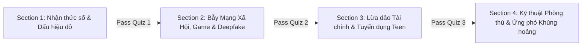

> 📱 **ỨNG DỤNG HỌC & LÀM BÀI TEST TRẮC NGHIỆM TƯƠNG TÁC:**  
> [**👉 Nhấp vào đây để mở Giao diện học tương tác và làm bài Quiz 20 câu mở khóa từng Section (/anti-scam/)**](/anti-scam/index.html)

---

# KHÓA HỌC: KỸ NĂNG PHÒNG CHỐNG LỪA ĐẢO TRỰC TUYẾN DÀNH CHO THANH THIẾU NIÊN (CYBER SAFETY FOR TEENS)

> **Mục tiêu:** Trang bị kiến thức, kỹ năng nhận diện và phản ứng nhanh trước các bẫy lừa đảo phổ biến trên không gian mạng hiện nay (mạng xã hội, tài chính, game, AI deepfake, tuyển dụng học sinh - sinh viên).
> 
> **Hình thức:** Khóa học gồm 4 Section chính (Lộ trình từ Cơ bản đến Nâng cao). Học viên phải hoàn thành bài trắc nghiệm (Pass rate: $\ge$ 80% tương đương tối thiểu 12/15 hoặc 16/20 câu đúng) của mỗi Section để mở khóa Section tiếp theo.

---

## 📌 LỘ TRÌNH TỔNG QUAN CÁC SECTION

---

## SECTION 1: NHẬN THỨC SỐ & BẢN ĐỒ CHIÊU TRÒ LỪA ĐẢO TRỰC TUYẾN

### 1.1. Mục tiêu bài học
* Hiểu tâm lý học của kẻ lừa đảo: Nỗi sợ hãi (Fear), Lòng tham/cám dỗ quà tặng (Greed), Tính tò mò (Curiosity), Sự khẩn cấp giả tạo (Urgency).
* Nhận diện các "Red Flags" (Dấu hiệu cảnh báo đỏ) phổ biến trong tin nhắn, email và liên kết web.
* Phân biệt tin nhắn chính thống và tin lừa đảo giả mạo (Phishing, Smishing).

### 1.2. Nội dung chi tiết
1. **Bài 1: Giải mã tâm lý kẻ lừa đảo trực tuyến**
   * Đánh vào sự thiếu kinh nghiệm của Gen Z và học sinh, sinh viên.
   * Kỹ thuật thao túng tâm lý xã hội (Social Engineering).
2. **Bài 2: Các dấu hiệu cảnh báo kinh điển (Red Flags)**
   * Yêu cầu hành động gấp gáp: *"Khóa tài khoản trong 24h nếu không bấm vào link"*, *"Trúng thưởng chỉ còn 5 phút"*.
   * Lỗi ngữ pháp, xưng hô kỳ lạ, địa chỉ gửi/tên miền mập mờ (VD: `vietcombank-login.xyz`, `facebook-security-check.cfd`).
   * Yêu cầu thông tin nhạy cảm: Mật khẩu, mã OTP, số CCCD/CMND.
3. **Bài 3: Nhận diện chiêu trò Giả mạo (Phishing / Brand Spoofing)**
   * Giả mạo trường học, giáo viên, ban quản trị trường yêu cầu đóng học phí qua STK cá nhân.
   * Giả danh cơ quan công an, tòa án, shipper dọa kiện tụng hoặc thu hồi gói hàng cấm.
4. **Tài liệu tham khảo & Đọc thêm:**
   * Cẩm nang Nhận diện và Phòng chống Lừa đảo trực tuyến (Cục An toàn thông tin - Bộ TT&TT).
   * Dự án Chống Lừa Đảo ([chongluadao.vn](https://chongluadao.vn)).

### 1.3. Bài kiểm tra đánh giá: Quiz Section 1 (20 câu hỏi)
* *Cơ chế:* 20 câu hỏi tình huống & trắc nghiệm 4 lựa chọn. Yêu cầu đạt tối thiểu 16/20 (80%) để hoàn thành.

<b>👉 Xem chi tiết 20 câu hỏi trắc nghiệm Section 1</b>

1. **Kẻ lừa đảo thường dựa vào yếu tố nào để thao túng nạn nhân?**
   * A. Sự am hiểu công nghệ của nạn nhân
   * B. Thao túng cảm xúc (sợ hãi, tham lam, tò mò, tạo cảm giác khẩn cấp) *(Đáp án đúng)*
   * C. Khả năng lập trình siêu việt
   * D. Các lỗ hổng phần cứng máy tính
2. **Bạn nhận được SMS: "Nha truong thong bao: Hoc sinh chua nop hoc phi ky 2, bam http://tranghocphi-edu.xyz de nop ngay neu khong se bi buoc thoi hoc". Đây là dấu hiệu gì?**
   * A. Thông báo chính thức của nhà trường
   * B. Lừa đảo Phishing kết hợp tạo sự hoảng loạn *(Đáp án đúng)*
   * C. Lỗi kỹ thuật của tổng đài
   * D. Cần chuyển khoản ngay để tránh bị đuổi học
3. **Tên miền nào dưới đây có độ tin cậy cao nhất của một cơ quan nhà nước Việt Nam?**
   * A. `congan-thanhpho.gov.vn` *(Đáp án đúng)*
   * B. `conganvn-ho-tro.com`
   * C. `chinhphu.net`
   * D. `kiemtrataikhoan-gov.top`
4. **Kỹ thuật "Social Engineering" (Thao túng tâm lý) là gì?**
   * A. Cài virus vào máy nạn nhân qua cổng USB
   * B. Lừa nạn nhân tự nguyện giao nộp thông tin bí mật thông qua tương tác tâm lý *(Đáp án đúng)*
   * C. Bẻ khóa mật khẩu bằng máy chủ cấu hình khủng
   * D. Tấn công từ chối dịch vụ (DDoS)
5. **Dấu hiệu nào KHÔNG PHẢI là dấu hiệu lừa đảo?**
   * A. Yêu cầu gửi mã OTP để "xác minh không phải robot"
   * B. Thông báo trúng iPhone 16 khi đang lướt web dù không tham gia quay thưởng
   * C. Thông báo từ website ngân hàng chính thức với tên miền chuẩn HTTPS và đúng domain đã công bố *(Đáp án đúng)*
   * D. Thúc ép "bạn chỉ có 3 phút để chuyển tiền giữ chỗ"
6. **Mã xác thực OTP (One Time Password) dùng để làm gì?**
   * A. Dùng để chia sẻ cho nhân viên ngân hàng/CSKH khi họ gọi điện hỗ trợ
   * B. Là mật khẩu dùng một lần để xác nhận giao dịch quan trọng và TUYỆT ĐỐI không chia sẻ cho bất kỳ ai *(Đáp án đúng)*
   * C. Là mật khẩu công khai để bạn bè chuyển tiền hộ
   * D. Mã coupon giảm giá shopee
7. **Kẻ gian thường dùng link rút gọn (bit.ly, tinyurl,...) nhằm mục đích gì?**
   * A. Tăng tốc độ tải trang
   * B. Ẩn giấu tên miền lừa đảo độc hại đằng sau *(Đáp án đúng)*
   * C. Tiết kiệm dung lượng mạng 4G
   * D. Giúp link hiển thị đẹp hơn trên Instagram
8. **Bạn nhận được cuộc gọi: "Tôi là Đại úy công an, tài khoản của bạn liên quan đến vụ án ma túy/rửa tiền, yêu cầu chuyển tiền vào tài khoản tạm giữ để thanh tra". Bạn nên làm gì?**
   * A. Làm theo lời họ ngay vì sợ bị bắt
   * B. Tắt máy ngay lập tức vì công an không làm việc qua điện thoại và không bao giờ yêu cầu chuyển tiền *(Đáp án đúng)*
   * C. Xin số tài khoản để vay tiền bạn bè nộp
   * D. Cung cấp mã OTP ngân hàng để họ kiểm tra
9. **Ký hiệu ổ khóa trên thanh địa chỉ trình duyệt web (HTTPS) có nghĩa là gì?**
   * A. Trang web này hoàn toàn an toàn và 100% không phải lừa đảo
   * B. Dữ liệu truyền giữa máy bạn và web được mã hóa, nhưng trang web đó VẪN CÓ THỂ là web lừa đảo *(Đáp án đúng)*
   * C. Trang web đã được chứng nhận bởi Bộ Công An
   * D. Máy tính của bạn không thể bị nhiễm virus
10. **Khi nhận một đường link lạ từ người lạ gửi qua Messenger, hành động an toàn nhất là:**
    * A. Nhấp vào xem ngay vì tính tò mò
    * B. Không nhấp vào, kiểm tra URL qua trang web kiểm tra an toàn hoặc hỏi người có chuyên môn *(Đáp án đúng)*
    * C. Chuyển tiếp ngay link đó cho tất cả bạn bè trong lớp
    * D. Nhấp vào và tải file đính kèm về mở
11. **Dấu hiệu ngữ pháp nào thường xuất hiện trong email/tin nhắn lừa đảo quốc tế gửi về Việt Nam?**
    * A. Sử dụng từ ngữ địa phương chuẩn mực
    * B. Lỗi dịch máy ngô nghê, xưng hô cộc lốc hoặc dùng sai từ ngữ phổ thông *(Đáp án đúng)*
    * C. Thơ lục bát
    * D. Viết bằng tiếng Anh chuẩn Oxford
12. **Chiêu trò "Smishing" là hình thức lừa đảo qua phương tiện nào?**
    * A. Tin nhắn SMS *(Đáp án đúng)*
    * B. Email
    * C. Cuộc gọi thoại trực tiếp
    * D. Thư tay qua bưu điện
13. **Nếu một người quen nhắn tin hỏi vay tiền khẩn cấp qua Facebook/Zalo, bạn nên làm gì trước tiên?**
    * A. Chuyển tiền ngay vì tình bạn bè thân thiết
    * B. Gọi điện thoại trực tiếp bằng SIM hoặc gặp mặt để xác thực giọng nói và danh tính người đó *(Đáp án đúng)*
    * C. Nhắn lại hỏi số tài khoản và chuyển luôn
    * D. Block luôn người bạn đó
14. **Kẻ lừa đảo thường tạo bẫy "Fear of Missing Out" (FOMO) bằng cách nào?**
    * A. Đăng tải danh sách học sinh giỏi
    * B. Tạo ưu đãi hời hiếm có nhưng giới hạn thời gian cực ngắn để nạn nhân không kịp suy nghĩ suy xét *(Đáp án đúng)*
    * C. Gửi bài tập về nhà
    * D. Nhắc nhở đi ngủ sớm
15. **Hành vi nào sau đây có nguy cơ để lộ thông tin nhận diện cá nhân (PII)?**
    * A. Đăng ảnh thẻ học sinh, CCCD, vé máy bay/vé concert rõ mã vạch lên Facebook/TikTok *(Đáp án đúng)*
    * B. Đổi mật khẩu định kỳ
    * C. Dùng tên biệt danh trên mạng xã hội
    * D. Bật tính năng xác thực 2 yếu tố
16. **Tên miền nào sau đây là tên miền giả mạo (Typosquatting) của Google?**
    * A. `google.com`
    * B. `g00gle.com` *(Đáp án đúng)*
    * C. `mail.google.com`
    * D. `accounts.google.com`
17. **Tại sao thanh thiếu niên lại là đối tượng mục tiêu béo bở của tội phạm mạng?**
    * A. Vì các bạn có nhiều tiền tiết kiệm hàng tỷ đồng
    * B. Vì tần suất online cao nhưng còn thiếu kinh nghiệm cảnh giác thực tế và tò mò khám phá *(Đáp án đúng)*
    * C. Vì tất cả thanh thiếu niên đều không biết dùng điện thoại
    * D. Vì pháp luật không bảo vệ người dưới 18 tuổi
18. **Dự án an ninh mạng cộng đồng nổi tiếng tại Việt Nam giúp cảnh báo và tra cứu website lừa đảo là:**
    * A. chongluadao.vn *(Đáp án đúng)*
    * B. xemfilm.online
    * C. napthegiare.com
    * D. kiemtiendo.biz
19. **Một tin nhắn thông báo: "Bạn đã trúng thưởng xe máy SH trong sự kiện tri ân của TikTok, chuyển 2 triệu phí ship để nhận giải". Bạn kết luận gì?**
    * A. May mắn thật, phải vay tiền nộp phí ngay
    * B. Lừa đảo trúng thưởng điển hình, giải thưởng hợp pháp không bắt người nhận trả phí trước kiểu này *(Đáp án đúng)*
    * C. TikTok thực sự tặng quà cho mọi tài khoản
    * D. Phải rủ bạn bè nhận cùng
20. **Nguyên tắc "Zero Trust" cơ bản trên không gian mạng có nghĩa là gì?**
    * A. Không tin tưởng bất kỳ thứ gì trên mạng, luôn kiểm chứng trước khi click hay chia sẻ thông tin *(Đáp án đúng)*
    * B. Tin tưởng hoàn toàn vào tin nhắn của bạn bè trên mạng
    * C. Không bao giờ dùng mạng internet nữa
    * D. Chỉ tin vào những trang có nhiều người theo dõi

---

## SECTION 2: BẪY MẠNG XÃ HỘI, GAME ONLINE & CÔNG NGHỆ DEEPFAKE AI

### 2.1. Mục tiêu bài học
* Nhận diện các bẫy lừa đảo thường gặp trong cộng đồng game thủ trẻ tuổi: Mua bán account, nạp thẻ giá rẻ, hack skin/mod game.
* Hiểu cách thức hoạt động của Deepfake (hình ảnh, video, giả giọng nói người thân) và cách vạch trần kẻ mạo danh.
* Phòng chống bẫy tống tiền tình dục (Sextortion), lừa đảo hẹn hò ảo (Romance Scam / Pig Butchering).

### 2.2. Nội dung chi tiết
1. **Bài 1: Bẫy Game Online & Thế giới ảo**
   * Lừa đảo mua bán tài khoản (Valorant, Liên Quân, Free Fire, Roblox, Genshin Impact...).
   * Phần mềm độc hại đội lốt "Tool Hack Game / Bản mod nhận Robux miễn phí".
   * Các trang nạp quân huy/kim cương chiết khấu 70-90% thực chất là bẫy đánh cắp tài khoản mạng xã hội.
2. **Bài 2: Trí tuệ nhân tạo (AI) & Kỷ nguyên Deepfake**
   * Giả lập video call khuôn mặt người thân giật lag, tiếng nói đứt quãng xin tiền gấp vì tai nạn, cấp cứu.
   * Cách lật tẩy video call Deepfake: Yêu cầu giơ tay vẫy trước mặt, quay góc nghiêng 90 độ, hỏi chi tiết kỷ niệm riêng tư chỉ 2 người biết.
3. **Bài 3: Cạm bẫy Tình cảm & Tống tiền hình ảnh nhạy cảm (Sextortion)**
   * Kẻ xấu giả vờ kết bạn, thả thính, dụ dỗ gửi ảnh/video nhạy cảm (nudes) rồi tống tiền, đe dọa gửi cho phụ huynh, bạn học.
   * Bẫy "Pig butchering" (Mổ heo): Nuôi dưỡng niềm tin tình cảm sau đó rủ rê đầu tư sàn tiền ảo.
4. **Tài liệu tham khảo & Đọc thêm:**
   * Hướng dẫn An toàn Trực tuyến cho Giới trẻ của UNICEF & DQ Institute.
   * Báo cáo về Sextortion nhắm vào trẻ vị thành niên của NCMEC (National Center for Missing & Exploited Children).

### 2.3. Bài kiểm tra đánh giá: Quiz Section 2 (20 câu hỏi)
* *Cơ chế:* 20 câu hỏi tình huống & trắc nghiệm 4 lựa chọn. Yêu cầu đạt tối thiểu 16/20 (80%) để hoàn thành.

<b>👉 Xem chi tiết 20 câu hỏi trắc nghiệm Section 2</b>

1. **Bạn thấy quảng cáo: "Tải app hack 999.999 Quân Huy miễn phí, không bị khóa acc". Tải về và cài đặt file `.apk` / `.exe` này sẽ dẫn đến kết quả gì?**
   * A. Nhận được full tướng và skin
   * B. Máy bị nhiễm mã độc trojan/keylogger, mất tài khoản game và Facebook *(Đáp án đúng)*
   * C. Được nhà phát hành game khen ngợi
   * D. Không có chuyện gì xảy ra
2. **Tại sao các web nạp thẻ game lậu lại yêu cầu nhập tài khoản Facebook/Google và mật khẩu?**
   * A. Để đồng bộ dữ liệu vào game
   * B. Đây là trang web câu cá (Phishing) để cướp trắng tài khoản của bạn *(Đáp án đúng)*
   * C. Để xác minh bạn đủ 18 tuổi
   * D. Để tặng quà sinh nhật
3. **Khi gọi video call xác minh, dấu hiệu nào nghi ngờ là video Deepfake?**
   * A. Khuôn mặt có viền mờ nhòe, nháy mắt bất thường, cử động miệng không khớp tiếng, khi có vật đưa qua mặt thì hình ảnh bị biến dạng *(Đáp án đúng)*
   * B. Hình ảnh sắc nét 4K mượt mà
   * C. Người nói trả lời trôi chảy các câu hỏi bí mật
   * D. Gọi được liên tục 2 tiếng không mất kết nối
4. **Cách đơn giản nhất để kiểm tra khi nghi ngờ một cuộc gọi video khẩn cấp từ bạn bè xin tiền là Deepfake:**
   * A. Hỏi mượn lại tiền họ
   * B. Yêu cầu họ giơ bàn tay vẫy trước mặt hoặc quay nghiêng đầu 90 độ, và hỏi câu hỏi riêng tư chỉ 2 người biết *(Đáp án đúng)*
   * C. Lập tức chuyển tiền vì thấy đúng mặt bạn mình
   * D. Nhắn tin chửi bới
5. **Hình thức tống tiền "Sextortion" nhắm vào thiếu niên diễn ra như thế nào?**
   * A. Kẻ lừa đảo dụ dỗ nạn nhân gửi ảnh/video nhạy cảm rồi đe dọa phát tán lên mạng nếu không nộp tiền hoặc gửi thêm clip *(Đáp án đúng)*
   * B. Kẻ trộm cắp máy tính xách tay ở trường học
   * C. Ép nạn nhân mua tài khoản Netflix
   * D. Hack máy chủ trường học
6. **Nếu lỡ gửi ảnh nhạy cảm cho người lạ trên mạng và bị đe dọa tống tiền, bạn nên làm gì?**
   * A. Chuyển tiền ngay cho họ (kẻ xấu thường sẽ tiếp tục đòi thêm tiền mãi)
   * B. Giữ bình tĩnh, không chuyển tiền, chụp lại toàn bộ bằng chứng, chặn liên lạc và chia sẻ ngay với phụ huynh/thầy cô/công an để được hỗ trợ *(Đáp án đúng)*
   * C. Xóa sạch mọi tài khoản mạng xã hội và giấu kín trong tuyệt vọng
   * D. Làm theo mọi yêu cầu chụp thêm ảnh quái gở của kẻ tống tiền
7. **"Trung gian uy tín" tự xưng trong các nhóm mua bán acc game trên Facebook thường là ai?**
   * A. Trọng tài được cấp phép chính thức của game
   * B. Đồng bọn hoặc tài khoản clone giả mạo của chính kẻ bán nhằm lừa người mua chuyển tiền *(Đáp án đúng)*
   * C. Nhân viên chăm sóc khách hàng của game
   * D. Người tốt giúp đỡ cộng đồng miễn phí
8. **Khi tham gia các nền tảng như Roblox, Discord, hành vi nào là NGUY HIỂM?**
   * A. Chia sẻ link `ROBLOSECURITY` cookie tài khoản khi người khác hứa cho đồ xịn *(Đáp án đúng)*
   * B. Tắt nhận tin nhắn từ người lạ trong server
   * C. Đặt mật khẩu phức tạp có ký tự đặc biệt
   * D. Bật bảo mật 2 lớp qua email cha mẹ
9. **Chiêu trò "Pig Butchering" (Vỗ béo rồi làm thịt) bắt đầu bằng hành động nào?**
   * A. Tấn công DDoS sập mạng nhà bạn
   * B. Kết bạn làm quen, thể hiện quan tâm lãng mạn tạo niềm tin sâu sắc trong thời gian dài rồi mới lôi kéo đầu tư/nạp tiền *(Đáp án đúng)*
   * C. Đe dọa đánh nhau
   * D. Gửi virus phá hỏng điện thoại
10. **Trang web cung cấp Robux miễn phí nhưng yêu cầu "Làm 5 bài khảo sát và tải 3 ứng dụng" thực chất là:**
    * A. Chương trình từ thiện của Roblox
    * B. Lừa đảo lượt tải (CPA scam) và thu thập thông tin cá nhân của bạn *(Đáp án đúng)*
    * C. Cách kiếm tiền chân chính của game thủ
    * D. Bản cập nhật mới của game
11. **Giọng nói giả mạo bằng AI (Voice Cloning) có thể được tạo ra từ đâu?**
    * A. Chỉ cần vài giây đoạn ghi âm giọng nói công khai từ TikTok/Facebook của nạn nhân *(Đáp án đúng)*
    * B. Bắt buộc phải có thiết bị phòng thu đắt tiền hàng tỷ đồng
    * C. Phải gặp trực tiếp nạn nhân lấy mẫu giọng 30 ngày
    * D. Kẻ gian phải có dây thanh quản giống hệt nạn nhân
12. **Một tài khoản "Hot girl/Hot boy" lạ trên Instagram chủ động nhắn tin làm quen, khen ngợi bạn hết lời và nhanh chóng ngỏ lời yêu đương. Bạn nên:**
    * A. Tự hào vì mình quá đào hoa và chia sẻ mọi bí mật
    * B. Cảnh giác, tìm kiếm hình ảnh đại diện qua Google Images xem có phải ảnh ăn cắp từ người mẫu mạng hay không *(Đáp án đúng)*
    * C. Gửi ngay ảnh thẻ học sinh cho họ xem
    * D. Mượn tiền mẹ mua quà tặng người đó
13. **File đính kèm nào gửi qua Discord từ người lạ có nguy cơ cao chứa mã độc đánh cắp tài khoản (Token Grabber)?**
    * A. File ảnh `.png` bình thường
    * B. File nén `.zip` chứa file `.exe` hoặc file script `.bat`, `.scr` giấu đuôi *(Đáp án đúng)*
    * C. File văn bản `.txt`
    * D. Link dẫn về trang chủ Wikipedia
14. **Khi bị mất quyền truy cập tài khoản Discord/Steam vì quét mã QR lạ, nguyên nhân là do:**
    * A. Bạn đã quét mã "Đăng nhập nhanh" cấp quyền truy cập thẳng vào tài khoản cho kẻ gian mà không đọc kỹ cảnh báo *(Đáp án đúng)*
    * B. Hỏng camera điện thoại
    * C. Mạng wifi bị chập
    * D. Do bàn phím bị kẹt phím
15. **Chiêu trò lừa đảo "Tặng skin CS:GO / Valorant bằng cách vote cho đội tuyển của tôi" hoạt động ra sao?**
    * A. Gửi quà thật 100%
    * B. Dẫn link đến một trang web đăng nhập giả mạo Steam/Riot để trộm tài khoản *(Đáp án đúng)*
    * C. Giúp bạn trở thành game thủ chuyên nghiệp
    * D. Không có nguy cơ nào
16. **Nền tảng mạng xã hội nào hiện nay có nguy cơ bị lộ thông tin vị trí thực tế nhiều nhất nếu không tắt quyền riêng tư?**
    * A. Bản đồ vị trí Snapchat (Snap Map) và tính năng Check-in Facebook/Instagram *(Đáp án đúng)*
    * B. Ứng dụng Calculator
    * C. Máy nghe nhạc offline
    * D. Trình duyệt file của máy
17. **Nếu bạn nhận được tin nhắn từ bạn thân trên Instagram: "Tôi đang tham gia cuộc thi ảnh, vote cho tôi bằng cách gửi lại mã 6 số vừa gửi về máy bạn nhé", mã 6 số đó thực chất là gì?**
    * A. Mã bình chọn hoa hậu
    * B. Mã đặt lại mật khẩu hoặc mã OTP đăng nhập tài khoản Instagram của CHÍNH BẠN *(Đáp án đúng)*
    * C. Điểm thưởng mini game
    * D. Mã giảm giá trà sữa
18. **Tổ chức quốc tế Take It Down (takeitdown.ncmec.org) hỗ trợ thanh thiếu niên điều gì?**
    * A. Hỗ trợ gỡ bỏ và ngăn chặn phát tán hình ảnh nhạy cảm của người dưới 18 tuổi trên internet *(Đáp án đúng)*
    * B. Tặng thẻ nạp game miễn phí
    * C. Cung cấp bài tập toán
    * D. Dạy chơi cờ vua
19. **Khi người mua acc game của bạn đề nghị gửi link thanh toán qua dịch vụ trung gian quốc tế lạ hoắc và bắt bạn nạp 500k để kích hoạt ví, bạn nên:**
    * A. Nạp ngay vì muốn bán được acc giá cao
    * B. Nhận diện ngay đây là chiêu thức lừa tiền kích hoạt ví ảo và dừng giao dịch *(Đáp án đúng)*
    * C. Đi mượn tiền để nạp thử
    * D. Gửi luôn mật khẩu acc cho họ
20. **Tại sao không nên dùng chung mật khẩu game cho tài khoản email cá nhân?**
    * A. Vì game sẽ chạy chậm hơn
    * B. Vì nếu lộ mật khẩu ở web game lừa đảo, kẻ gian sẽ chiếm quyền luôn cả email gốc và toàn bộ tài khoản khác *(Đáp án đúng)*
    * C. Vì vi phạm luật an ninh mạng
    * D. Vì các chữ cái sẽ bị biến mất

---

## SECTION 3: BẪY TÀI CHÍNH, TIỀN ẢO & TUYỂN DỤNG "VIỆC NHẸ LƯƠNG CAO" CHO TEEN

### 3.1. Mục tiêu bài học
* Vạch trần chiêu bài tuyển dụng online: Dịch phụ đề, gõ văn bản tại nhà, bẫy giật đơn hàng Shopee/Lazada, làm mẫu ảnh nhí/học sinh.
* Cảnh báo bẫy tài chính học đường: Vay tiền qua app tín dụng đen, lôi kéo chơi "sàn nhị phân BO / coin rác", nhận mở tài khoản ngân hàng hộ (cho thuê/mượn tài khoản).
* Nhận thức rõ ràng về hậu quả pháp lý hình sự khi vô tình trở thành mắt xích rửa tiền cho tội phạm.

### 3.2. Nội dung chi tiết
1. **Bài 1: Tuyển dụng "Việc nhẹ lương cao" trên mạng xã hội**
   * Đánh vào tâm lý muốn kiếm tiền phụ giúp gia đình hoặc tự lập tài chính của học sinh, sinh viên.
   * Kịch bản "Giật đơn hàng hưởng hoa hồng": Mồi nhử nạp 100k nhận 130k -> Nạp 1 triệu nhận 1.3 triệu -> Đơn cuối nạp 20 triệu rồi giam tiền với lý do sai cú pháp.
   * Bẫy "Cộng tác viên lồng tiếng/dịch thuật/đọc sách thu âm": Bắt nạp tiền cọc dữ liệu hợp đồng.
2. **Bài 2: Hiểm họa Cho thuê, Cho mượn tài khoản ngân hàng & Mở thẻ hộ**
   * Kẻ gian trả 500k - 2 triệu đồng để học sinh sinh viên mở tài khoản và bán lại.
   * Hệ quả pháp lý: Tài khoản bị dùng để nhận tiền lừa đảo, rửa tiền xuyên biên giới. Người mở tài khoản trở thành đồng phạm hình sự.
3. **Bài 3: Tín dụng đen & Các hình thức đa cấp tiền số học đường**
   * Vay tiền qua app chụp ảnh CMND/CCCD và danh bạ điện thoại: Lãi suất cắt cổ 1000%/năm, bị khủng bố gọi điện cho cả trường học và gia đình.
   * Lôi kéo tham gia hội nhóm đầu tư Forex, Crypto cam kết lãi 30%/tháng.
4. **Tài liệu tham khảo & Đọc thêm:**
   * Bộ luật Hình sự Việt Nam: Tội mua bán, cho thuê tài khoản ngân hàng (Điều 291).
   * Chuỗi cảnh báo của Cục An ninh mạng và phòng, chống tội phạm sử dụng công nghệ cao (A05).

### 3.3. Bài kiểm tra đánh giá: Quiz Section 3 (20 câu hỏi)
* *Cơ chế:* 20 câu hỏi tình huống & trắc nghiệm 4 lựa chọn. Yêu cầu đạt tối thiểu 16/20 (80%) để hoàn thành.

<b>👉 Xem chi tiết 20 câu hỏi trắc nghiệm Section 3</b>

1. **Công việc "Gõ văn bản tại nhà, ngày làm 2 tiếng lương 500k, yêu cầu cọc 200k tiền phí giữ bài" là gì?**
   * A. Cơ hội việc làm hấp dẫn cho học sinh
   * B. Chiêu trò lừa đảo chiếm đoạt tiền cọc *(Đáp án đúng)*
   * C. Doanh nghiệp nhà nước tuyển dụng
   * D. Học bổng tài năng
2. **Kịch bản lừa đảo "Cộng tác viên Shopee/Tiki chốt đơn nhận hoa hồng" thường kết thúc như thế nào?**
   * A. Nạn nhân nhận lương hàng tháng đều đặn
   * B. Sau khi dẫn dụ nạp số tiền lớn vào đơn hàng ảo, hệ thống báo lỗi cú pháp và bắt nạp thêm để cứu tiền rồi cắt liên lạc *(Đáp án đúng)*
   * C. Nạn nhân được trở thành giám đốc chi nhánh
   * D. Nạn nhân nhận được hàng thật miễn phí
3. **Một người bạn cùng lớp trả bạn 1 triệu đồng để bạn cầm CCCD ra ngân hàng mở 3 tài khoản và đưa thông tin thẻ cho họ. Bạn nên làm gì?**
   * A. Làm ngay vì kiếm 1 triệu quá dễ
   * B. Từ chối dứt khoát và báo cáo nhà trường/phụ huynh vì hành vi này vi phạm pháp luật nghiêm trọng *(Đáp án đúng)*
   * C. Mở thêm 10 tài khoản cho cả gia đình để kiếm nhiều tiền hơn
   * D. Nhờ bạn bè trong lớp cùng mở
4. **Hậu quả pháp lý của việc cho thuê, bán tài khoản ngân hàng là gì?**
   * A. Không bị sao cả vì tiền không phải của mình
   * B. Bị xử phạt hành chính lên tới hàng chục triệu đồng, có thể bị truy cứu trách nhiệm hình sự về tội rửa tiền hoặc đồng phạm lừa đảo *(Đáp án đúng)*
   * C. Được ngân hàng tặng điểm tích lũy
   * D. Chỉ bị khóa tài khoản 2 ngày
5. **App vay tiền online bất hợp pháp (tín dụng đen) thường yêu cầu quyền truy cập gì trên điện thoại để uy hiếp con nợ?**
   * A. Quyền truy cập bluetooth
   * B. Quyền truy cập toàn bộ Danh bạ điện thoại, Hình ảnh và Vị trí *(Đáp án đúng)*
   * C. Quyền bật đèn pin flash
   * D. Quyền truy cập ứng dụng máy tính cầm tay
6. **Khi không trả được nợ app đen, các đối tượng đòi nợ thường làm gì?**
   * A. Ghép ảnh thờ, ảnh nhạy cảm bôi nhọ gửi cho thầy cô, bạn bè, người thân trong danh bạ để khủng bố tinh thần *(Đáp án đúng)*
   * B. Gửi thư chúc mừng sinh nhật
   * C. Bỏ qua và xóa nợ
   * D. Mời đi uống cà phê tâm sự
7. **Bản chất của các hội nhóm "Kéo vốn đầu tư tài chính, cam kết bao lỗ, sinh lời 20-30%/tháng" là:**
   * A. Tổ chức từ thiện quốc tế
   * B. Mô hình lừa đảo Ponzi (lấy tiền người sau trả cho người trước rồi ôm tiền bỏ trốn) *(Đáp án đúng)*
   * C. Quỹ đầu tư mạo hiểm hợp pháp
   * D. Cơ quan thuế nhà nước
8. **Dấu hiệu nào cho thấy một thông báo tuyển dụng việc làm thêm là ĐÁNG TIN CẬY?**
   * A. Không yêu cầu kinh nghiệm, lương cao bất thường, làm tại nhà, bắt đóng tiền cọc
   * B. Có hợp đồng lao động rõ ràng, công ty có mã số thuế và trụ sở thực tế, không yêu cầu đóng bất kỳ khoản tiền cọc nào *(Đáp án đúng)*
   * C. Trao đổi qua Telegram với nick ẩn danh
   * D. Chuyển tiền qua STK cá nhân
9. **Kẻ lừa đảo tuyển "Mẫu ảnh học sinh chụp Lookbook" thường giở trò gì trong buổi phỏng vấn online?**
   * A. Đo size quần áo chuyên nghiệp
   * B. Dụ dỗ học sinh cởi đồ để "kiểm tra số đo cơ thể" qua camera rồi bí mật quay lại để tống tiền *(Đáp án đúng)*
   * C. Tặng quà miễn phí giá trị lớn
   * D. Cho ký hợp đồng người mẫu ngay
10. **Lý do vì sao các giao dịch lừa đảo hiện nay thường yêu cầu chuyển qua Telegram mà không dùng Zalo hay Facebook?**
    * A. Telegram chạy mượt hơn
    * B. Telegram có tính năng xóa tin nhắn 2 chiều, mã hóa bí mật, nick ẩn danh và rất khó cho cơ quan điều tra truy vết *(Đáp án đúng)*
    * C. Telegram do chính phủ thành lập
    * D. Telegram không tốn pin
11. **Khi kẻ lừa đảo bảo: "Bạn nạp sai cú pháp mã đơn hàng, phải nạp thêm gấp đôi số tiền để kích hoạt đóng băng ví", đây là biểu hiện của:**
    * A. Lỗi máy chủ ngân hàng thật
    * B. Chiêu thức giữ chân và vơ vét thêm tiền của nạn nhân trước khi chặn liên lạc *(Đáp án đúng)*
    * C. Hệ thống tự động bảo vệ tiền của bạn
    * D. Ưu đãi nhân đôi tài khoản
12. **Một người tự xưng là "Chuyên gia tài chính 2k" chụp ảnh khoe xe sang, nhà xịn, xấp tiền đô trên TikTok thực chất là:**
    * A. Người giàu tự thân chân chính
    * B. Hình ảnh dàn dựng nhằm tạo vỏ bọc hào nhoáng lùa gà vào các sàn cờ bạc/tiền ảo trá hình *(Đáp án đúng)*
    * C. Tỷ phú hảo tâm muốn chia sẻ tài sản
    * D. Doanh nhân được tạp chí Forbes vinh danh
13. **Tại sao không được chụp ảnh 2 mặt của Căn cước công dân (CCCD) đăng công khai lên mạng xã hội?**
    * A. Vì kẻ xấu có thể dùng thông tin và số định danh để đăng ký vay app lậu, mở tài khoản ngân hàng ảo, mạo danh lừa đảo *(Đáp án đúng)*
    * B. Vì ảnh chụp CCCD thường không đẹp bằng ảnh sống ảo
    * C. Vì làm mờ ống kính điện thoại
    * D. Không có nguy cơ nào
14. **Hành vi "đánh giá sản phẩm trên sàn thương mại điện tử nhận tiền" (đặt hàng ảo) có vi phạm không?**
    * A. Hoàn toàn hợp pháp và được khuyến khích
    * B. Vi phạm chính sách của các sàn, gian lận thương mại và 99% là bình phong của các đường dây lừa đảo *(Đáp án đúng)*
    * C. Là một môn thể thao điện tử
    * D. Được bảo hộ bởi luật lao động
15. **Khi một app tài chính yêu cầu nạp tiền để "rút tiền lợi nhuận ra", nguyên tắc vàng là:**
    * A. Nạp thêm tiền ngay để rút được vốn
    * B. Tuyệt đối không nạp thêm bất kỳ một đồng nào, vì bạn sẽ mất thêm toàn bộ số tiền vừa nạp *(Đáp án đúng)*
    * C. Cầm cố đồ đạc để nạp cho đủ
    * D. Chờ 30 phút rồi nạp
16. **Thuật ngữ "Lùa gà" trong giới tài chính mạng dùng để chỉ:**
    * A. Hoạt động chăn nuôi nông nghiệp thông minh
    * B. Hành vi dụ dỗ những người thiếu kiến thức, nhẹ dạ cả tin vào bẫy đầu tư thua lỗ để kẻ tạo cuộc chơi trục lợi *(Đáp án đúng)*
    * C. Trò chơi điện tử nông trại
    * D. Hoạt động mua bán gia cầm trực tuyến
17. **Nếu bạn nhận được khoản tiền lạ vài triệu đồng chuyển nhầm vào tài khoản cá nhân, bạn nên làm gì?**
    * A. Rút ra tiêu xài ngay lập tức
    * B. Giữ nguyên số tiền, không chuyển cho bất kỳ ai tự nhận là chủ tiền qua tin nhắn riêng, liên hệ ngay với ngân hàng hoặc công an để xử lý tra soát chính thức *(Đáp án đúng)*
    * C. Chuyển tiếp vào tài khoản bạn bè giữ hộ
    * D. Đăng bài lên Facebook khoe trúng lộc
18. **Bẫy chuyển tiền nhầm rồi bắt đền lãi suất cao (giả vờ chuyển nhầm biến nạn nhân thành con nợ vay nặng lãi) xử lý ra sao?**
    * A. Chuyển trả ngay vào số tài khoản mới mà người lạ nhắn tin yêu cầu
    * B. Chỉ làm việc trực tiếp tại quầy giao dịch ngân hàng với sự chứng kiến của nhân viên ngân hàng và cơ quan công an *(Đáp án đúng)*
    * C. Tự ý thương lượng lãi suất qua Zalo
    * D. Chặn số điện thoại người đó là xong
19. **Thẻ tín dụng / Thẻ ghi nợ quốc tế (Visa, Mastercard) có dãy 3 số bảo mật ở mặt sau tên là gì và có được cho người khác xem không?**
    * A. CVV/CVC, phải dán che lại và tuyệt đối không cho bất kỳ ai chụp lại *(Đáp án đúng)*
    * B. Mã số định danh học sinh, cho xem thoải mái
    * C. Mã vạch giảm giá tại rạp chiếu phim
    * D. Ngày tháng năm sinh của chủ thẻ
20. **Ai là người chịu trách nhiệm đầu tiên trước pháp luật nếu tài khoản ngân hàng của bạn bị sử dụng trong một vụ án rửa tiền?**
    * A. Giám đốc chi nhánh ngân hàng
    * B. Chính bạn - người đứng tên đăng ký mở tài khoản đó *(Đáp án đúng)*
    * C. Người tạo ra chiếc điện thoại
    * D. Giáo viên chủ nhiệm

---

## SECTION 4: KỸ THUẬT PHÒNG THỦ SỐ & KỊCH BẢN ỨNG PHÓ KHỦNG HOẢNG

### 4.1. Mục tiêu bài học
* Thiết lập pháo đài bảo mật cá nhân: Mật khẩu mạnh, Xác thực 2 bước (2FA bằng Authenticator app), Quản lý quyền riêng tư thiết bị.
* Nắm vững quy trình phản ứng nhanh 5 bước (Incident Response) khi nhận ra mình đã bị lừa hoặc bị lộ thông tin nhạy cảm.
* Danh bạ các đường dây nóng (Hotline) hỗ trợ khẩn cấp tại Việt Nam.

### 4.2. Nội dung chi tiết
1. **Bài 1: Pháo đài bảo mật cá nhân (Digital Hygiene)**
   * Nguyên tắc đặt mật khẩu: Passphrase dài $\ge$ 12 ký tự, không dùng ngày sinh, tên người yêu, số điện thoại.
   * Tại sao 2FA qua SMS không còn an toàn tuyệt đối (bẫy SIM Swap)? Chuyển sang Google Authenticator / Microsoft Authenticator / Khóa bảo mật FIDO.
   * Vệ sinh dữ liệu số: Định kỳ kiểm tra danh sách thiết bị đăng nhập, gỡ bỏ app rác, tắt quyền truy cập vị trí/danh bạ không cần thiết.
2. **Bài 2: Quy trình 5 bước Phản ứng nhanh khi dính bẫy lừa đảo**
   * **Bước 1: Cắt đứt kết nối:** Ngắt mạng internet (Wifi/4G), cô lập thiết bị nếu nghi dính mã độc.
   * **Bước 2: Khóa khẩn cấp:** Gọi hotline ngân hàng khóa thẻ, khóa tài khoản giao dịch điện tử ngay lập tức.
   * **Bước 3: Thu thập bằng chứng:** Chụp màn hình tin nhắn, số tài khoản nhận tiền, lịch sử chuyển khoản, link web (không bấm xóa tin nhắn).
   * **Bước 4: Đổi thông tin bảo mật:** Đổi mật khẩu email gốc và các tài khoản quan trọng từ một thiết bị sạch khác.
   * **Bước 5: Trình báo & Tìm kiếm trợ giúp:** Báo cáo phụ huynh, thầy cô, trình báo cơ quan công an địa phương và Cục An toàn thông tin.
3. **Bài 3: Danh bạ khẩn cấp & Công cụ cứu nạn số tại Việt Nam**
   * Đường dây nóng Cảnh báo an toàn thông tin Việt Nam: Tổng đài `156` (miễn phí phản ánh cuộc gọi/tin nhắn rác, lừa đảo).
   * Tổng đài Quốc gia Bảo vệ Trẻ em: `111` (tư vấn tâm lý, can thiệp khi bị tống tiền, bạo lực mạng).
   * Cổng cảnh báo an toàn thông tin: `canhbao.ncsc.gov.vn`.
   * Dự án Chống Lừa Đảo: Báo cáo website lừa đảo qua tiện ích trình duyệt hoặc trang web `chongluadao.vn`.

### 4.3. Bài kiểm tra đánh giá: Quiz Section 4 (20 câu hỏi)
* *Cơ chế:* 20 câu hỏi tình huống & trắc nghiệm 4 lựa chọn. Yêu cầu đạt tối thiểu 16/20 (80%) để hoàn thành.

<b>👉 Xem chi tiết 20 câu hỏi trắc nghiệm Section 4</b>

1. **Mật khẩu nào sau đây là mạnh và an toàn nhất?**
   * A. `12345678`
   * B. `NguyenVanA2008`
   * C. `c0nMe0_Tre0_C4y_K3_19#` *(Đáp án đúng)*
   * D. `iloveyou`
2. **Phương thức xác thực 2 yếu tố (2FA) nào an toàn và ít rủi ro bị can thiệp nhất hiện nay?**
   * A. Nhận mã qua tin nhắn SMS
   * B. Ứng dụng tạo mã xác thực (Google Authenticator, Microsoft Authenticator) hoặc Khóa bảo mật vật lý *(Đáp án đúng)*
   * C. Nhận mã qua cuộc gọi thoại thông thường
   * D. Không cần cài đặt gì
3. **Hiện tượng "SIM Swap" (Chiếm đoạt SIM) gây nguy hiểm như thế nào?**
   * A. Làm điện thoại nhanh hết pin
   * B. Kẻ gian làm giả SIM để cướp số điện thoại của bạn, từ đó nhận mã OTP đặt lại toàn bộ mật khẩu ngân hàng và mạng xã hội *(Đáp án đúng)*
   * C. Làm tăng cước điện thoại hàng tháng
   * D. Mất danh bạ offline
4. **Khi bạn lỡ bấm vào một đường link lạ và máy tự động tải một file về, bạn nên làm gì ngay?**
   * A. Mở file đó ra xem ngay bên trong có gì
   * B. Tuyệt đối không bấm mở file, xóa ngay khỏi thư mục Download, tắt kết nối mạng và dùng phần mềm diệt virus quét máy *(Đáp án đúng)*
   * C. Gửi file đó cho bạn bè nhờ mở hộ
   * D. Tắt màn hình đi ngủ
5. **Bước đầu tiên cần làm ngay khi phát hiện vừa chuyển tiền cho kẻ lừa đảo qua ứng dụng ngân hàng là gì?**
   * A. Khóc lóc và xóa app ngân hàng
   * B. Gọi ngay đến số hotline khẩn cấp của ngân hàng yêu cầu hỗ trợ khóa tài khoản/khóa giao dịch và xin hỗ trợ tra soát giao dịch *(Đáp án đúng)*
   * C. Nhắn tin năn nỉ kẻ lừa đảo trả lại tiền
   * D. Đăng bài chửi bới lên Facebook cá nhân
6. **Tại sao việc chụp màn hình lại toàn bộ tin nhắn trao đổi với kẻ lừa đảo là rất quan trọng?**
   * A. Để làm kỷ niệm thời học sinh
   * B. Để lưu giữ bằng chứng pháp lý đầy đủ cung cấp cho cơ quan công an khi nộp đơn tố giác tội phạm *(Đáp án đúng)*
   * C. Để bán cho báo chí kiếm tiền
   * D. Không cần thiết vì kẻ lừa đảo sẽ tự nhận tội
7. **Đường dây nóng miễn phí tiếp nhận thông tin phản ánh về tin nhắn rác, cuộc gọi rác và cuộc gọi có dấu hiệu lừa đảo tại Việt Nam là số mấy?**
   * A. `156` *(Đáp án đúng)*
   * B. `1900`
   * C. `1080`
   * D. `911`
8. **Tổng đài Quốc gia Bảo vệ Trẻ em tại Việt Nam hỗ trợ tư vấn tâm lý và can thiệp bảo vệ thanh thiếu niên bị xâm hại trên mạng là:**
   * A. `111` *(Đáp án đúng)*
   * B. `113`
   * C. `114`
   * D. `115`
9. **Sau khi tài khoản mạng xã hội bị hack và vừa lấy lại được, việc quan trọng cần làm đầu tiên là gì?**
   * A. Đổi mật khẩu mới và chọn tính năng "Đăng xuất khỏi tất cả các thiết bị khác" *(Đáp án đúng)*
   * B. Đăng ảnh selfie ăn mừng
   * C. Xóa hết bạn bè cũ
   * D. Tắt tính năng bảo mật 2 lớp
10. **Khi nhận thấy một website có dấu hiệu giả mạo ngân hàng hoặc cơ quan nhà nước, bạn nên báo cáo tại đâu?**
    * A. Trang web `canhbao.ncsc.gov.vn` hoặc `chongluadao.vn` *(Đáp án đúng)*
    * B. Bình luận khen ngợi trên trang web đó
    * C. Không cần báo cáo cho ai
    * D. Gửi cho toàn bộ học sinh trong trường cùng vào xem
11. **Tính năng "Quản lý quyền ứng dụng" (App Permissions) trên smartphone giúp ích gì cho bạn?**
    * A. Giúp điện thoại chơi game mượt hơn
    * B. Kiểm soát và chặn các ứng dụng độc hại lén lút đọc danh bạ, vị trí, camera và micro của bạn *(Đáp án đúng)*
    * C. Tự động mua hàng giảm giá
    * D. Tăng độ sáng màn hình
12. **Một người tự xưng là "Hacker mũ trắng / Luật sư hỗ trợ lấy lại tiền lừa đảo online" cam kết lấy lại 100% tiền đã mất với phí 20% đặt cọc trước. Đây là:**
    * A. Cứu tinh giúp bạn lấy lại tiền
    * B. Chiêu trò lừa đảo lần hai (Secondary Scam), tiếp tục đánh vào tâm lý tiếc tiền của nạn nhân để chiếm đoạt thêm tiền cọc *(Đáp án đúng)*
    * C. Dịch vụ hợp pháp được nhà nước công nhận
    * D. Nhân viên ngân hàng hỗ trợ ngoài giờ
13. **Tại sao bạn không bao giờ nên dùng Wifi công cộng mở (không có mật khẩu) tại quán cà phê để đăng nhập tài khoản ngân hàng?**
    * A. Vì mạng Wifi công cộng sẽ làm chậm tốc độ chuyển tiền
    * B. Vì kẻ gian có thể thực hiện tấn công Man-in-the-Middle (nghe lén dữ liệu trên cùng mạng) để đánh cắp thông tin đăng nhập *(Đáp án đúng)*
    * C. Vì quán cà phê sẽ thu thêm phí phụ thu
    * D. Vì điện thoại sẽ bị hao pin gấp đôi
14. **Khi lỡ tiết lộ mã OTP cho người khác, bạn phải làm gì ngay trong 30 giây tiếp theo?**
    * A. Đổi ngay mã PIN/mật khẩu ứng dụng ngân hàng hoặc gọi tổng đài khẩn cấp khóa chức năng giao dịch điện tử *(Đáp án đúng)*
    * B. Ngồi đợi xem tiền có bị trừ không
    * C. Nhắn tin chúc kẻ lừa đảo may mắn
    * D. Xóa app ngân hàng
15. **Kẻ lừa đảo thường yêu cầu nạn nhân giấu kín chuyện với gia đình bằng cách dọa dẫm: "Nói cho bố mẹ biết bạn sẽ bị công an bắt đi tù". Mục đích của chúng là gì?**
    * A. Muốn bảo vệ bạn khỏi sự la mắng của cha mẹ
    * B. Cô lập nạn nhân để nạn nhân hoảng loạn, không có ai có kinh nghiệm hỗ trợ cảnh báo và ngăn chặn chuyển tiền *(Đáp án đúng)*
    * C. Thể hiện sự tôn trọng quyền riêng tư của bạn
    * D. Giúp bạn rèn luyện tính độc lập
16. **Nơi tiếp nhận đơn trình báo tố giác tội phạm lừa đảo công nghệ cao chính thống nhất tại địa phương là:**
    * A. Cơ quan Công an xã/phường/quận/huyện nơi bạn cư trú hoặc Đội An ninh mạng & Phòng chống tội phạm công nghệ cao *(Đáp án đúng)*
    * B. Hội nhóm Zalo "Hỗ trợ đòi nợ"
    * C. Quán net gần nhà
    * D. Trụ sở bưu điện
17. **Cơ chế hoạt động của tiện ích Chống Lừa Đảo (tiện ích mở rộng trên Chrome/Cốc Cốc) là gì?**
    * A. Tự động tắt máy tính khi có nguy hiểm
    * B. Cảnh báo và ngăn chặn người dùng truy cập vào các đường link lừa đảo, độc hại đã được cộng đồng và chuyên gia an ninh mạng gắn cờ *(Đáp án đúng)*
    * C. Chặn các trang web làm bài tập về nhà
    * D. Đọc trộm tin nhắn của người dùng
18. **Nếu một người bạn thân trong lớp của bạn có dấu hiệu buồn bã, sợ hãi, xin vay tiền khắp nơi và không dám kể lý do, bạn nên làm gì?**
    * A. Cho bạn vay thật nhiều tiền không hỏi han gì
    * B. Bỏ mặc vì không phải việc của mình
    * C. Lắng nghe, chia sẻ chân thành và khuyên bạn nên tâm sự ngay với giáo viên chủ nhiệm hoặc chuyên gia tâm lý/cha mẹ để giải quyết bẫy tống tiền hoặc nợ nần *(Đáp án đúng)*
    * D. Đăng bài châm chọc bạn trên confessions trường
19. **Khi thay điện thoại mới và muốn bán lại điện thoại cũ, thao tác quan trọng nhất để bảo vệ dữ liệu cá nhân là gì?**
    * A. Xóa vài bức ảnh xấu
    * B. Đăng xuất các tài khoản và thực hiện "Khôi phục cài đặt gốc" (Factory Reset) toàn bộ thiết bị *(Đáp án đúng)*
    * C. Dán lại kính cường lực mới
    * D. Đổi vỏ ốp lưng điện thoại
20. **Tư duy cốt lõi nhất để một thiếu niên trở thành "Công dân số thông thái" trong thời đại số là:**
    * A. Chậm lại 1 nhịp - Kiểm tra đa nguồn độc lập - Luôn trao đổi với người có uy tín trước khi quyết định các giao dịch tiền tệ/thông tin nhạy cảm *(Đáp án đúng)*
    * B. Ai nói gì trên mạng cũng tin ngay
    * C. Cố gắng thử click vào tất cả các link khuyến mãi xem có may mắn không
    * D. Giấu kín mọi rắc rối xảy ra trên mạng với người lớn

---

## 🛠️ HƯỚNG DẪN TRIỂN KHAI VÀ SỬ DỤNG
1. **Dành cho học sinh/học viên:**
   * Học tuần tự từ Section 1 đến Section 4.
   * Đọc kỹ các case study tình huống thực tế và các dấu hiệu nhận diện.
   * Làm bài kiểm tra Quiz ở cuối mỗi section. Đạt điểm số $\ge 80\%$ để được mở khóa tài liệu section kế tiếp.
2. **Dành cho giảng viên / Người hướng dẫn:**
   * Có thể sử dụng nội dung từng Section để xây dựng slide bài giảng hoặc minigame tương tác.
   * Câu hỏi trắc nghiệm có thể import trực tiếp vào các nền tảng: Google Forms, Kahoot, Quizizz, Canvas, Moodle.
