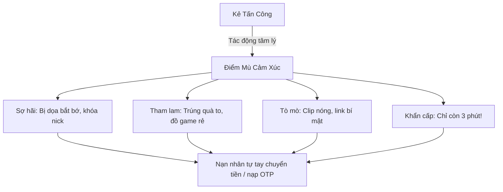

# Bài 1.1: Giải Mã Tâm Lý Học Tội Phạm Mạng (Social Engineering)

> **Mục tiêu:** Hiểu rõ tại sao con người luôn là mắt xích yếu nhất trong chuỗi bảo mật an ninh mạng và cách tội phạm thao túng cảm xúc của thanh thiếu niên.

---

## 1. Bản chất của Social Engineering là gì?
Trong an ninh mạng, **Social Engineering (Kỹ thuật thao túng tâm lý xã hội)** là phương pháp mà kẻ tấn công đánh lừa nạn nhân để họ tự nguyện cung cấp thông tin bí mật, cấp quyền truy cập hoặc tự tay chuyển tiền cho kẻ xấu.

Kẻ gian không cần dùng các dàn siêu máy tính để giải mã mật khẩu phức tạp; chúng chỉ cần nói chuyện, thuyết phục hoặc dọa nạt để bạn **tự giao chìa khóa cho chúng**.

---

## 2. Các đòn bẩy tâm lý phổ biến đánh vào Gen Z

### A. Nỗi sợ hãi & Uy quyền giả mạo (Fear & Authority)
- Giả danh thầy cô, ban giám hiệu: *"Học sinh chưa nộp học phí hoặc vi phạm quy chế thi, click link xác minh ngay nếu không sẽ bị đình chỉ học"*.
- Giả danh công an, tòa án: *"Tài khoản của bạn liên quan đến đường dây rửa tiền xuyên quốc gia, chuyển tiền vào tài khoản tạm giữ để thanh tra"*.
- **Tâm lý nạn nhân:** Học sinh sợ ảnh hưởng học bạ, sợ cha mẹ biết, sợ bị đi tù nên vội vàng làm theo mọi yêu cầu.

### B. Lòng tham & Bẫy quà tặng (Greed & Free Gifts)
- Thông báo trúng thưởng ngẫu nhiên iPhone 16 Pro Max, xe máy SH, chuyến du lịch nước ngoài.
- Yêu cầu: Đóng "phí xuất kho", "thuế trước bạ" 500k - 2 triệu đồng để nhận hàng trị giá hàng chục triệu.

### C. Cảm giác khẩn cấp giả tạo (False Urgency)
- Đếm ngược đồng hồ tích tắc: *"Tài khoản sẽ bị vô hiệu hóa trong 15 phút"*, *"Chỉ còn 3 suất học bổng duy nhất"*.
- **Mục đích:** Khiến não bộ rơi vào trạng thái hoảng loạn và hành động theo bản năng, không kịp bàn bạc hay hỏi ý kiến người khác.

---

## 3. Bài học thực hành & Nguyên tắc phòng vệ
- **Quy tắc 5 giây:** Khi nhận được bất kỳ tin nhắn giật gân nào, hãy dừng lại hít thở sâu 5 giây. Không nhấp link, không chuyển tiền ngay lập tức.
- **Kiểm chứng độc lập:** Gọi điện trực tiếp bằng sóng điện thoại SIM thông thường (không gọi qua app mạng xã hội) cho người gửi để xác minh.
