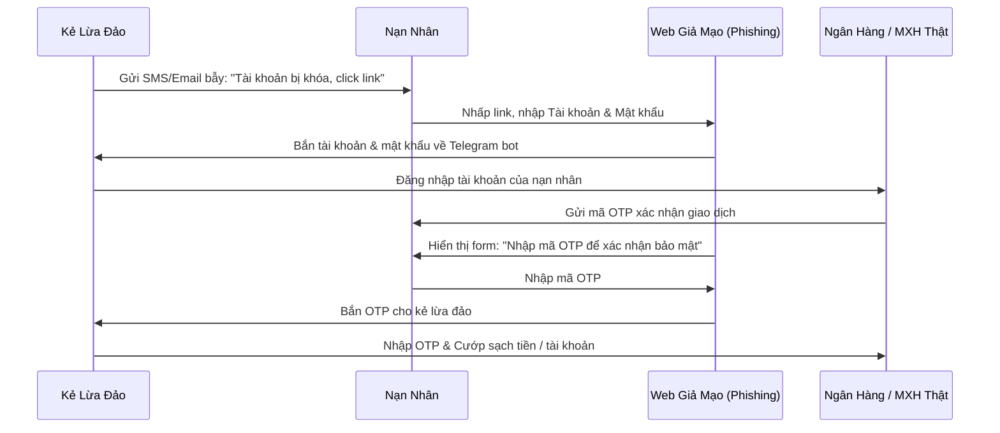

# Bài 1.3: Nhận Diện Chiêu Trò Giả Mạo (Phishing & Smishing)

> **Mục tiêu:** Phân biệt Phishing, Smishing và nắm rõ thủ đoạn dùng trạm BTS giả mạo để không bao giờ bị sập bẫy tin nhắn lừa đảo.

---

## 1. Phishing (Tấn công câu cá) hoạt động như thế nào?

---

## 2. Smishing & Hiểm họa từ Trạm BTS giả mạo

### Trạm BTS giả là gì?
- Kẻ gian mang theo thiết bị phát sóng di động giả mạo (Fake BTS) di chuyển bằng ba lô, xe máy hoặc ô tô.
- Thiết bị này phát công suất mạnh đè sóng của nhà mạng chính thức (Viettel, VinaPhone, MobiFone), ép điện thoại của người dân gần đó kết nối vào trạm giả.
- Khi đã kết nối, kẻ gian gửi hàng loạt SMS chèn thẳng vào luồng tin nhắn chính thức của ngân hàng (Brandname Vietcombank, Techcombank, MB, Viettel...).

> [!IMPORTANT]
> **Quy tắc bất di bất dịch:**
> Dù tin nhắn SMS nằm chung luồng với tin nhắn thật của ngân hàng từ trước đến nay, **TUYỆT ĐỐI KHÔNG BAO GIỜ** nhấp vào link kèm trong SMS. Ngân hàng tại Việt Nam hiện đã ngừng toàn bộ việc đính kèm liên kết web vào tin nhắn SMS thông báo.
