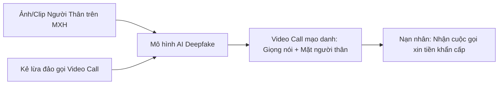

# Bài 2.2: Kỷ Nguyên Deepfake AI & Kỹ Thuật Lật Tẩy Cuộc Gọi Video Giả

> **Mục tiêu:** Hiểu rõ cách thức hoạt động của Deepfake khuôn mặt và giọng nói, làm chủ phản xạ vạch trần kẻ mạo danh người thân.

---

## 1. Công nghệ Deepfake hoạt động như thế nào?
- **AI Face Swap (Hoán đổi khuôn mặt):** Kẻ gian thu thập hình ảnh của người thân bạn từ Facebook/Instagram công khai, sau đó dùng mô hình học sâu để ghép khuôn mặt đó lên mặt kẻ lừa đảo trong lúc gọi video trực tiếp.
- **AI Voice Cloning (Giả mạo giọng nói):** Chỉ cần một đoạn clip âm thanh từ 3-5 giây trên TikTok hay Reel, công cụ AI có thể đọc bất kỳ văn bản nào bằng chính chất giọng, ngữ điệu và hơi thở của nạn nhân.

---

## 2. Các dấu hiệu lật tẩy video call Deepfake
1. **Thời lượng cuộc gọi rất ngắn:** Kẻ gian chỉ gọi từ 5 đến 10 giây rồi cố tình tắt máy với lý do: *"Mạng yếu quá", "Sóng bệnh viện chập chờn, nhắn tin số tài khoản nhé"*.
2. **Khuôn mặt có viền mờ nhòe:** Khi người gọi cử động đầu, vùng viền khuôn mặt thường có hiện tượng bóng mờ, nhòe pixel.
3. **Cử động mắt và miệng thiếu tự nhiên:** Mắt ít chớp, hoặc chớp giật cục; khẩu hình môi không khớp chính xác với âm thanh phát ra.

---

## 3. Các mẹo thực chiến bẻ gãy Deepfake tại chỗ
Nếu bạn nhận được cuộc gọi video khẩn cấp từ bạn bè xin tiền:
- **Hành động 1:** Yêu cầu họ giơ bàn tay vẫy qua vẫy lại trước khuôn mặt. Thuật toán AI Deepfake sẽ không xử lý kịp lớp che phủ và làm khuôn mặt bị biến dạng hoặc lộ mặt thật của kẻ gian.
- **Hành động 2:** Yêu cầu quay nghiêng góc đầu 90 độ sang trái hoặc phải.
- **Hành động 3:** Hỏi một câu hỏi bí mật về kỷ niệm riêng tư mà người ngoài không thể biết: *"Hôm nọ đi ăn ốc với nhau ai trả tiền?", "Thầy chủ nhiệm lớp 9 tên gì?"*.
