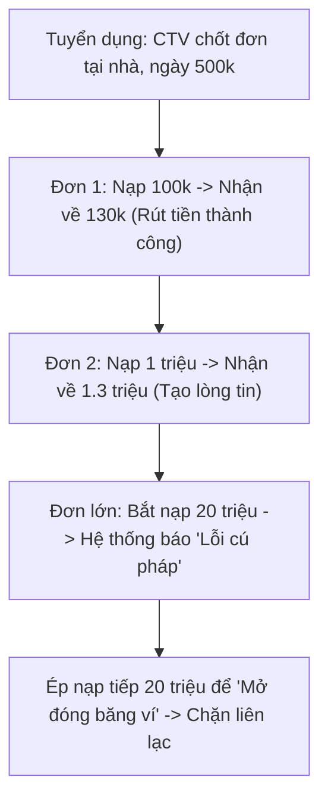

# Bài 3.1: Bẫy Tuyển Dụng "Việc Nhẹ Lương Cao" & Cộng Tác Viên Giật Đơn

> **Mục tiêu:** Nhận diện các bẫy tuyển dụng việc làm thêm trá hình nhắm vào học sinh, sinh viên thiếu kinh nghiệm.

---

## 1. Kịch bản bẫy Giật đơn hàng / Cộng tác viên Shopee, TikTok Shop

- **Nguyên lý lừa đảo:** Kẻ xấu chấp nhận bỏ ra vài trăm nghìn tiền mồi nhử ban đầu để xây dựng lòng tin tuyệt đối của bạn. Khi bạn đã tin rằng đây là cơ hội kiếm tiền dễ dàng, chúng sẽ tung cú chốt hạ với số tiền hàng chục triệu đồng.

---

## 2. Bẫy Tuyển "Mẫu ảnh học sinh / Lookbook Teen"
- Kẻ xấu đăng bài tuyển mẫu ảnh học sinh chụp quảng cáo quần áo với thù lao 2-5 triệu/buổi.
- Trong buổi phỏng vấn qua video call:
  - Yêu cầu ứng viên cởi bỏ trang phục để "kiểm tra số đo 3 vòng" và "độ phù hợp của làn da".
  - Kẻ xấu lén quay lại màn hình video call và dùng video đó để tống tiền nạn nhân.

---

## 3. Dấu hiệu nhận diện công việc tuyển dụng lừa đảo
- Không yêu cầu kinh nghiệm, kỹ năng nhưng cam kết thu nhập cao bất thường.
- Yêu cầu ứng viên nộp các loại phí: **Tiền cọc giữ chỗ, phí tài liệu, phí mua đơn hàng**.
- Toàn bộ giao dịch làm việc và hướng dẫn chuyển qua nhóm kín **Telegram**.
