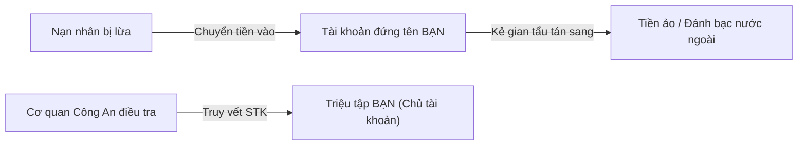

# Bài 3.2: Hiểm Họa Cho Thuê, Mua Bán Tài Khoản Ngân Hàng & Rủi Ro Pháp Lý

> **Mục tiêu:** Cảnh báo nghiêm khắc về trách nhiệm pháp lý khi đứng tên mở tài khoản ngân hàng hoặc bán thẻ cho người khác.

---

## 1. Chiêu bài mua bán tài khoản ngân hàng học đường
- Kẻ gian dụ dỗ học sinh vừa đủ 18 tuổi hoặc có CCCD: *"Cần mở tài khoản ngân hàng online để làm marketing, trả công 500k - 1 triệu đồng/tài khoản"*.
- Nhiều bạn học sinh nghĩ rằng: *"Tài khoản đứng tên mình nhưng mình không có tiền trong đó thì mất mát gì đâu"*, và rủ rê cả bạn bè trong lớp cùng mở thẻ để kiếm tiền tiêu vặt.

---

## 2. Số phận của các tài khoản ngân hàng đó đi về đâu?
Kẻ xấu gom hàng trăm tài khoản ngân hàng của học sinh, sinh viên để làm:
1. **Tài khoản nhận tiền lừa đảo:** Nhận tiền từ các vụ lừa đảo giật đơn, bắt cóc online, tống tiền.
2. **Kênh rửa tiền xuyên biên giới:** Chuyển tiền từ các đường dây đánh bạc online qua Campuchia, Philippines.

---

## 3. Chế tài Xử phạt & Trách nhiệm Hình sự
- Theo **Điều 291 Bộ luật Hình sự Việt Nam**: Hành vi thu thập, tàng trữ, trao đổi, mua bán, công khai hóa trái phép thông tin về tài khoản ngân hàng có thể bị phạt tiền đến 500 triệu đồng hoặc **phạt tù từ 3 tháng đến 7 năm**.
- Bạn sẽ bị phong tỏa toàn bộ tài khoản ngân hàng trong tương lai, bị ghi vào danh sách đen của ngành tài chính (khó vay vốn, mở thẻ sau này) và phải đối mặt với án phạt tù với vai trò đồng phạm lừa đảo.
