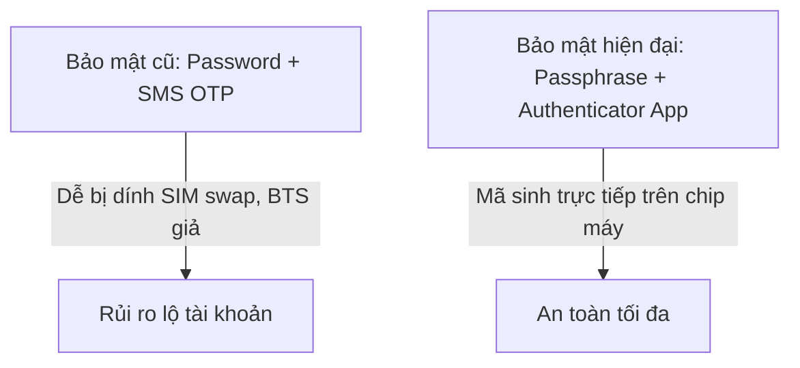

# Bài 4.1: Thiết Lập Pháo Đài Bảo Mật Cá Nhân & 2FA An Toàn

> **Mục tiêu:** Xây dựng hàng rào bảo mật vững chắc cho danh tính số của bạn trên mọi thiết bị và dịch vụ trực tuyến.

---

## 1. Nghệ thuật đặt Mật khẩu: Chuyển sang Passphrase
- Không sử dụng mật khẩu ngắn hoặc chứa thông tin cá nhân: ngày sinh, số điện thoại, tên crush.
- **Khái niệm Passphrase:** Ghép một chuỗi các từ có ý nghĩa thành một câu dài $\ge 14$ ký tự, có dấu gạch nối hoặc ký tự đặc biệt.
  - *Ví dụ kém an toàn:* `Kien2008@`
  - *Ví dụ cực mạnh:* `ToiThichAnPhoBo_HaNoi_VaoMuaDong#99`

---

## 2. Tại sao 2FA qua SMS không còn an toàn tuyệt đối?
- **Tấn công Hoán đổi SIM (SIM Swap):** Kẻ gian dùng giấy tờ giả ra điểm giao dịch nhà mạng báo mất SIM để làm lại SIM mới mang số của bạn. Ngay sau khi SIM mới kích hoạt, SIM trong máy bạn mất sóng và toàn bộ mã OTP SMS chuyển thẳng vào máy kẻ gian.
- **Giải pháp:** Sử dụng ứng dụng tạo mã xác thực 2 yếu tố dựa trên thời gian (TOTP) như **Google Authenticator**, **Microsoft Authenticator** hoặc Khóa bảo mật vật lý (FIDO2 YubiKey).

