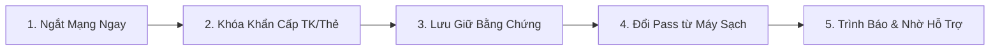

# Bài 4.2: Quy Trình 5 Bước Phản Ứng Nhanh Khi Dính Bẫy Lừa Đảo

> **Mục tiêu:** Nắm vững kịch bản ứng phó sự cố (Incident Response) để giảm thiểu tối đa thiệt hại tài sản và tâm lý.

---

## 1. Quy trình phản ứng khẩn cấp 5 bước

1. **Bước 1: Ngắt kết nối mạng ngay lập tức:**
   - Tắt Wifi và ngắt 4G/5G trên thiết bị nếu nghi ngờ vừa tải file có mã độc hoặc vô tình bấm vào liên kết lạ. Việc này ngăn chặn mã độc gửi dữ liệu và token đăng nhập về máy chủ của kẻ tấn công.
2. **Bước 2: Khóa khẩn cấp thẻ và tài khoản ngân hàng:**
   - Mở app ngân hàng khóa tính năng giao dịch trực tuyến hoặc gọi hotline tổng đài ngân hàng yêu cầu phong tỏa tài khoản khẩn cấp.
3. **Bước 3: Thu thập và bảo lưu chứng cứ:**
   - Chụp ảnh màn hình toàn bộ tin nhắn, trang cá nhân của kẻ xấu, số điện thoại, số tài khoản nhận tiền và biên lai chuyển khoản. Tuyệt đối **không xóa tin nhắn** vì đây là bằng chứng pháp lý quan trọng.
4. **Bước 4: Đổi mật khẩu từ một thiết bị sạch khác:**
   - Dùng một điện thoại/máy tính an toàn khác để đổi mật khẩu email gốc và chọn tính năng: **"Đăng xuất khỏi tất cả các thiết bị khác"**.
5. **Bước 5: Lên tiếng tìm kiếm trợ giúp:**
   - Nói chuyện ngay với người lớn trong gia đình, thầy cô giáo và làm đơn trình báo tại cơ quan Công an xã/phường/quận gần nhất.
